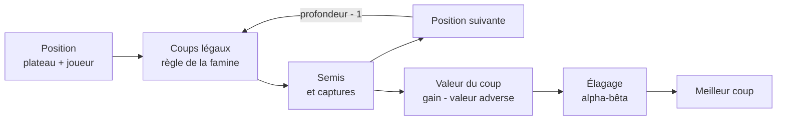

# awale-ai

[](https://github.com/Adamz-OG/awale-ai/actions/workflows/tests.yml)
[](https://www.python.org/)
[](LICENSE)

Moteur de jeu d'Awalé et IA MinMax avec élagage alpha-bêta, écrits en Python pur (aucune dépendance externe).

```console
$ awale suggest "1 7 0 3 0 1 / 1 0 5 6 1 5" --depth 4 --all
   l    k    j    i    h    g     player 2
+----+----+----+----+----+----+
|  5 |  1 |  6 |  5 |  0 |  1 |
+----+----+----+----+----+----+
|  1 |  7 |  0 |  3 |  0 |  1 |
+----+----+----+----+----+----+
   a    b    c    d    e    f     player 1

player 1 to move, depth 4
best move : f
score     : +2 (seeds of player 1 minus player 2)
nodes     : 111 in 0.000 s
all moves : a: +0  b: -3  d: -1  f: +2
```

## Objectif

L'Awalé est un jeu de semailles de la famille des mancalas : deux rangées de 6 cases, 48 graines, et le but est d'en capturer plus que l'adversaire. Chaque coup déplace beaucoup de graines, ce qui rend le jeu difficile à calculer de tête.

Le but du projet est de construire une IA qui choisit ses coups en explorant toutes les suites possibles (backtracking) et en supposant que l'adversaire joue au mieux (MinMax). Au-delà de l'algorithme, je voulais un vrai programme : des règles exactes, une recherche assez rapide pour voir loin, un mode de jeu dans le terminal et des mesures de la force de l'IA.

## Fonctionnalités

- **Règles complètes** de l'énoncé : semis anti-horaire, captures en chaîne de 2 ou 3 graines, interdiction d'affamer l'adversaire, fin de partie.
- **Énumération de toutes les suites de coups** jusqu'à une profondeur donnée, avec leur score, par un vrai backtracking (générateur, mémoire constante).
- **MinMax** sous forme négamax, et **élagage alpha-bêta** avec les captures essayées en premier : même résultat, beaucoup moins de positions visitées.
- **Score de chaque coup** possible, comme la première ligne d'un arbre MinMax (`--all`).
- **Partie contre l'IA** dans le terminal (`awale play`) et **matchs entre IA** de profondeurs différentes (`awale match`).
- **Interface de l'énoncé** conservée (`play`, `is_end`, `enum`, `suggest` sur un plateau en deux listes).
- Script de **benchmark** reproductible : coût de la recherche et force de jeu selon la profondeur.

## Installation

Python 3.10 ou plus récent.

```bash
git clone https://github.com/Adamz-OG/awale-ai.git
cd awale-ai
python -m venv .venv
source .venv/bin/activate        # Windows : .venv\Scripts\activate
pip install -e ".[dev]"          # installe la commande awale et les outils de test
```

Sans installation, on peut aussi lancer `PYTHONPATH=src python -m awale ...` depuis la racine du dépôt.

## Utilisation

### En ligne de commande

```bash
awale suggest                                   # meilleur coup sur le plateau de départ
awale suggest "1 7 0 3 0 1 / 1 0 5 6 1 5" -d 10 # plateau donné, 10 coups d'avance
awale suggest "..." --player 2 --all            # coup du joueur 2 et score de chaque coup
awale play --depth 8                            # jouer contre l'IA (vous êtes le joueur 1)
awale play --depth 8 --human 2                  # l'IA commence
awale match 6 2 --openings 20                   # IA de profondeur 6 contre profondeur 2
```

Le plateau s'écrit avec les 12 nombres de graines : la rangée du joueur 1 (cases `a` à `f`), puis celle du joueur 2 (cases `g` à `l`), dans l'ordre du semis. La profondeur compte des demi-coups : `-d 8` regarde 4 coups de chaque joueur. Pendant une partie, on joue une case par sa lettre ou par son numéro de 1 à 6, et `q` permet d'abandonner.

Sur l'exemple du début, le coup `d` prend 2 graines tout de suite et `b` permet d'en gagner 5 si l'adversaire répond mal. MinMax suppose qu'il répond bien : `b` coûte alors 3 graines, `d` en coûte 1, et seul `f` garantit d'en gagner 2.

### Depuis Python

```python
from awale import Searcher, from_rows, initial_board

board = from_rows([[1, 7, 0, 3, 0, 1], [1, 0, 5, 6, 1, 5]])
result = Searcher().search(board, player=0, depth=10)
print(result.move, result.score, result.nodes)   # 3 2 17916

Searcher().evaluate_moves(initial_board(), 0, 6) # score de chaque coup
```

## Tests et qualité

```bash
pytest                       # 123 tests
pytest --cov=awale           # couverture : 99 %
ruff check src tests benchmarks
mypy src tests               # typage strict
```

Les tests couvrent chaque module séparément : plateau, règles, recherche, parties et matchs, interface de l'énoncé et ligne de commande. Plusieurs tests vérifient des propriétés sur des centaines de positions aléatoires plutôt que des exemples :

- **MinMax de référence** : les trois méthodes de recherche (MinMax, alpha-bêta, alpha-bêta avec tri des coups) donnent le même coup et le même score qu'un MinMax classique écrit indépendamment dans les tests ;
- **conservation des graines** : graines sur le plateau et graines capturées restent égales à 48 tout au long d'une partie ;
- **symétrie** : échanger les deux rangées et le joueur donne le même coup et le score opposé ;
- **semis** : le semis rapide donne exactement le même plateau qu'un semis graine par graine.

La réécriture passe aussi les tests fournis avec l'énoncé (ils ne sont pas inclus dans le dépôt). Un workflow GitHub Actions relance le lint, le typage et les tests sous Python 3.10 à 3.13 à chaque push.

## Résultats

Mesures obtenues avec `python benchmarks/benchmark.py` (Python 3.13, Linux). Le coût de la recherche est la moyenne sur 50 positions reproductibles (la position de départ et 49 positions de milieu de partie) ; toutes les méthodes renvoient le même coup sur chaque position.

| Profondeur | MinMax | Alpha-bêta (ordre des cases) | Alpha-bêta (captures d'abord) | Temps MinMax | Temps alpha-bêta |
|---:|---:|---:|---:|---:|---:|
| 2 | 30 | 18 | 17 | 0,0 ms | 0,0 ms |
| 4 | 710 | 165 | 115 | 0,8 ms | 0,2 ms |
| 6 | 16 969 | 1 283 | 667 | 18,6 ms | 1,8 ms |
| 7 | 83 441 | 3 910 | 1 619 | 88,9 ms | 3,8 ms |
| 8 | trop lent | 8 472 | 3 175 | trop lent | 7,6 ms |
| 10 | trop lent | 57 735 | 15 493 | trop lent | 36,5 ms |
| 12 | trop lent | trop lent | 69 236 | trop lent | 167,7 ms |

Les colonnes de nombres comptent les positions visitées pour choisir un coup. Pour la force de jeu, chaque IA joue 40 parties contre l'IA de profondeur 1 (qui prend le plus de graines tout de suite) : 20 ouvertures aléatoires, jouées une fois de chaque côté.

| Profondeur | Contre la profondeur 1 | Graines par partie | Contre ma version 2025 |
|---:|---:|---:|---:|
| 2 | 35 victoires, 5 défaites | 27,9 contre 15,6 | 39 victoires sur 40 |
| 4 | 36 victoires, 4 défaites | 29,5 contre 14,1 | 40 victoires sur 40 |
| 6 | 40 victoires sur 40 | 33,3 contre 11,0 | 40 victoires sur 40 |
| 8 | 40 victoires sur 40 | 34,6 contre 9,1 | non mesuré |

Ce qu'il faut retenir :

- À profondeur 7, l'élagage alpha-bêta évite **98 %** des positions de MinMax et va 23 fois plus vite, pour exactement le même coup.
- Essayer les captures en premier divise encore par 3,7 le nombre de positions à profondeur 10 : les coupures arrivent plus tôt quand le bon coup est examiné d'abord.
- Le coût reste exponentiel, mais il grossit d'environ 2,2 par demi-coup au lieu de 4,9 pour MinMax : en Python pur, on regarde 12 demi-coups en moins de 0,2 s.
- Plus l'IA regarde loin, plus elle gagne : dès la profondeur 6, elle bat l'IA gloutonne dans toutes les parties.

Par rapport à ma version de 2025 (position de départ, même machine) :

| Profondeur | Version 2025 | Réécriture | Rapport |
|---:|---:|---:|---:|
| 4 | 16,7 ms | 0,42 ms | × 40 |
| 6 | 452,2 ms | 2,44 ms | × 185 |
| 7 | 2 006,1 ms | 3,49 ms | × 574 |
| 8 | 13 424,5 ms | 10,87 ms | × 1 235 |

L'ancienne version gardait en mémoire toutes les suites de coups (28,7 Mo pour les 139 157 suites de la profondeur 7) et choisissait la meilleure suite au lieu d'appliquer MinMax : sur 500 positions à profondeur 4, elle jouait un coup moins bon que le vrai MinMax dans 42 % des cas. À profondeur égale (2, 4 et 6), la nouvelle IA gagne 119 parties sur 120 contre elle.

## Comment ça marche



1. **Plateau** : les 12 cases forment une seule suite, dans l'ordre du semis. La case qui suit la case `i` est toujours `(i + 1) % 12`, d'une rangée à l'autre.
2. **Coups légaux** : on joue chaque case non vide, puis on retire les coups qui laissent l'adversaire sans graine, sauf si tous les coups le font.
3. **Semis et captures** : avec `n` graines, chaque case reçoit `n // 12` graines, puis les `n % 12` cases suivantes une de plus. Si la dernière graine tombe chez l'adversaire sur une case de 2 ou 3 graines, on les prend et on recule tant que la règle s'applique.
4. **Négamax** : la valeur d'un coup est le nombre de graines qu'il prend moins la valeur de la position qu'il laisse à l'adversaire. À la profondeur 0 ou en fin de partie, la valeur vaut 0. Le score de l'énoncé (joueur 1 moins joueur 2) s'en déduit par le signe.
5. **Alpha-bêta** : chaque appel reçoit une fenêtre [alpha, bêta]. Dès qu'un coup atteint bêta, l'adversaire n'aurait jamais laissé jouer cette position : on arrête d'examiner les autres coups.
6. **Choix** : à la racine, on garde le coup de meilleure valeur ; en cas d'égalité, la case la plus à gauche.

### Plateau

| Indices | Cases | Joueur |
|---:|---|---|
| 0 à 5 | `a b c d e f` | joueur 1, de gauche à droite |
| 6 à 11 | `g h i j k l` | joueur 2, de droite à gauche vu du joueur 1 |

## Structure du dépôt

```
awale-ai/
├── src/awale/
│   ├── board.py        # plateau (12 cases dans l'ordre du semis), lecture, affichage
│   ├── rules.py        # semis, captures, règle de la famine, fin de partie
│   ├── search.py       # énumération des suites, MinMax, alpha-bêta
│   ├── game.py         # parties, joueurs (IA, hasard), matchs
│   ├── compat.py       # interface de l'énoncé : play, is_end, enum, suggest
│   ├── cli.py          # commandes suggest, play, match
│   └── __main__.py     # python -m awale
├── tests/              # un fichier de tests par module
├── benchmarks/benchmark.py
├── .github/workflows/tests.yml
├── pyproject.toml
└── LICENSE
```

## Choix techniques

- **Un plateau immuable de 12 cases dans l'ordre du semis.** Un tuple remplace la liste de deux listes : la case suivante est toujours `(i + 1) % 12`, sans cas particulier au passage d'une rangée à l'autre. Un nouveau plateau se crée en une copie, sans `deepcopy`, et il ne peut pas être modifié par erreur pendant la recherche.
- **Un semis en temps constant.** `divmod(graines, 12)` donne le nombre de tours complets et le reste : 12 opérations au plus, quel que soit le nombre de graines, au lieu d'une boucle graine par graine.
- **Le négamax plutôt que deux fonctions max et min.** Comme le score est une somme de captures, une seule fonction sert aux deux joueurs : valeur d'un coup = graines prises moins valeur de la position adverse. C'est plus court et il n'y a pas deux versions à garder cohérentes.
- **L'élagage alpha-bêta, avec les captures d'abord.** Il donne exactement le même résultat que MinMax (vérifié par les tests), mais ignore les branches qui ne peuvent plus changer la décision. Trier les coups par graines capturées est presque gratuit, puisque chaque coup est déjà joué pour vérifier la règle de la famine.
- **Des coups légaux qui portent leur résultat.** `legal_moves` renvoie pour chaque coup le plateau obtenu et les graines prises : la recherche les réutilise au lieu de rejouer le coup.
- **Une énumération par générateur.** Le chemin courant est une pile (`append` puis `pop`) : c'est un vrai backtracking, et les 139 157 suites de la profondeur 7 (depuis la position de départ) sont produites une par une au lieu d'être gardées en mémoire.
- **Des égalités départagées par la case la plus à gauche.** Le résultat est déterministe, et toutes les méthodes de recherche choisissent le même coup, ce qui permet de les comparer.
- **Pas de table de transposition.** Je l'ai essayée : sur 30 positions à profondeur 10, elle évitait moins de 5 % des positions et rendait la recherche plus lente. À l'Awalé, deux ordres de coups mènent rarement au même plateau. Je l'ai retirée pour garder un code simple.
- **Une limite de 300 coups dans les matchs entre IA.** En fin de partie, quelques graines peuvent tourner sans fin sans qu'aucun joueur ne puisse capturer : la partie est alors arrêtée et gagnée par celui qui a le plus de graines.

## Limites et pistes

- La valeur d'une position ne compte que les graines capturées pendant la recherche. Une fonction d'évaluation (graines en réserve, cases vulnérables à 1 ou 2 graines) améliorerait le jeu à profondeur égale.
- La profondeur est fixe. Un approfondissement itératif avec une limite de temps permettrait de jouer en temps limité et de mieux trier les coups grâce à l'itération précédente.
- Les règles sont celles de l'énoncé, pas celles des tournois : la case de départ n'est pas sautée à partir de 12 graines, une prise de toutes les graines adverses n'est pas annulée et les graines restantes en fin de partie ne sont pas attribuées. Ces variantes pourraient devenir des options.
- Python pur : environ 400 000 positions par seconde avec l'alpha-bêta. Une version en C++ ou une recherche parallèle irait plus loin dans le même temps.
- Les répétitions de positions ne sont pas détectées, d'où la limite de coups dans les matchs.

## Ce que j'ai appris

- La différence entre la **meilleure suite de coups** et **MinMax** : ma première version supposait que l'adversaire m'aidait. Mesurer qu'elle se trompait dans 42 % des positions m'a montré qu'il faut tester le comportement, pas seulement quelques exemples.
- L'**élagage alpha-bêta** et l'importance de l'**ordre des coups**, mesurée plutôt que supposée.
- **Mesurer avant de complexifier** : la table de transposition, qui semblait une bonne idée, n'apportait rien ici.
- Choisir une **représentation des données** qui simplifie l'algorithme : 12 cases dans l'ordre du semis suppriment presque tous les cas particuliers.
- Écrire des **tests de propriétés** (conservation des graines, symétrie, comparaison avec un MinMax de référence) et organiser un projet Python propre : paquet `src/`, `pyproject.toml`, Pytest, ruff, mypy strict, intégration continue.

## Contexte

Projet réalisé à l'origine en mars 2025 dans le cadre du cours INFO-F103 Algorithmique 1 à l'Université libre de Bruxelles (ULB), puis entièrement réécrit en 2026 : règles corrigées, vrai MinMax avec élagage alpha-bêta, partie dans le terminal, matchs entre IA, tests et mesures.

## Licence

MIT, voir [LICENSE](LICENSE).
